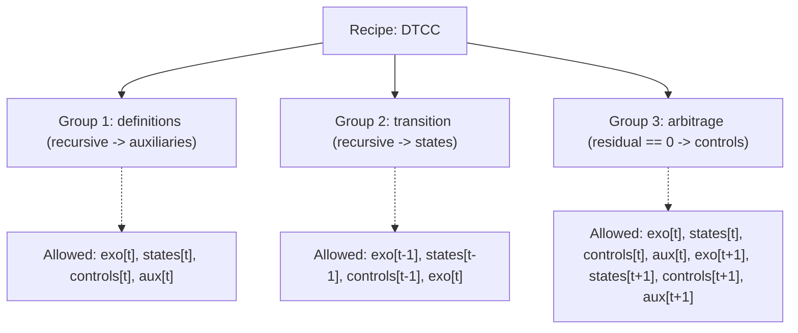

# Model Recipes & Conformity Checking

Different computational algorithms (perturbation, projection methods, value function iteration, global solving) require models to obey distinct mathematical structures and timing conventions.

DynSpec introduces **Model Recipes** (`dyno.dynspec.recipe`): formal, programmatic specifications of model structure that validate whether a set of equations conforms to a target solution paradigm. Recipes are read from YAML files, and checking only depends on DynSpec.

---

## 1. What is a Recipe?

A **`Recipe`** defines:

1. **Variable Groups**: Valid classifications for variables (e.g. `exogenous`, `states`, `controls`, `auxiliaries`, `parameters`).
2. **Equation Groups**: Named blocks of equations with strict rules on:
   - Which variable groups may appear and at what time shifts (`allowed`).
   - Which variable group the equations define (`target`).
   - Whether the block is evaluated recursively or as a simultaneous zero-residual system (`recursive`).
   - Expected equation count (`n_equations`).



---

## 2. Recipes Files

Recipes are written in YAML, in the format of dolo's `recipes.yaml`. The
bundled file (`dyno/dynspec/recipes.yaml`) defines the `dtcc` recipe; other
files can be read with `load_recipes`:

```python
from dyno.dynspec import get_recipe, load_recipes

dtcc = get_recipe("dtcc")                 # bundled recipe (same as DTCC_RECIPE)
recipes = load_recipes("my_recipes.yaml")  # {name: Recipe}
```

An equation group lists the variable groups allowed at each time shift
(`eqs`), and optionally the group its equations define (`target`):

```yaml
dtcc:
    symbols: [exogenous, states, controls, auxiliaries, parameters]
    processes: exogenous        # group of the variables declared as processes
    specs:
        transition:
            target: [states, 0, S]
            eqs:
                - [exogenous, -1, m]
                - [states, -1, s]
                - [controls, -1, x]
                - [exogenous, 0, M]
                - [parameters, 0, p]
        arbitrage:
            eqs: [...]
            complementarities:
                left-right:             # allowed in the bounds
                    - [exogenous, 0, m]
                    - [states, 0, s]
                    - [parameters, 0, p]
                middle: [controls, 0, x]  # the bounded variables
```

Other keys: `optional` (the group may be absent), `recursive` (target
equations must form a DAG; default when there is a target) and `n_equations`
(the variable group whose size is the number of equations; defaults to the
target, or to the bounded group of complementarities).

### The DTCC recipe

DynSpec bundles a recipe for **Discrete Time Continuous Controls (DTCC)**
models, compatible with the dolo framework:

| Group | Target | Nature | Timing Allowed |
|---|---|---|---|
| `definitions` (optional) | `auxiliaries` | Recursive assignment | $m_t, s_t, x_t, y_t$ |
| `transition` | `states` | Recursive state evolution | $m_{t-1}, s_{t-1}, x_{t-1}, m_t$ |
| `arbitrage` | None | Simultaneous residual $= 0$, with complementarities on $x_t$ | $m_t, s_t, x_t, y_t, m_{t+1}, s_{t+1}, x_{t+1}, y_{t+1}$ |
| `arbitrage_bounds` (optional) | None | Bound expressions | $m_t, s_t$ |
| `controls_lb`, `controls_ub` (optional) | `controls` | Standalone bounds `x[t] = ...` | $m_t, s_t$ |

Parameters are allowed everywhere.

---

## 3. Checking a Group of Equations

`check_group` checks the equations of one equation group of a recipe, given
the variable names of each variable group. Equations can be given as source
text, a list of strings, or parsed trees:

```python
from dyno.dynspec import check_group

variables = {
    "exogenous": ["e_z"],
    "states": ["z", "k"],
    "controls": ["n", "i"],
}

result = check_group(
    """
    z[t] = rho*z[t-1] + e_z[t]
    k[t] = (1-delta)*k[t-1] + i[t-1]
    """,
    "transition",
    variables,
    recipe="dtcc",  # the default
)

if result.ok:
    print("Topological evaluation order:", result.dag_order)
else:
    print(result)
```

`check_equation_group` is the lower-level function behind it: it takes parsed
equation trees and an `EquationGroupSpec` instead of names.

### Violation Reporting

A `ConformityResult` lists every `Violation`, with the position of the
equation in the group, its source line, the offending variable and the
reason, e.g.:

```text
✗ transition: 1 violation(s)
  - Equation 1 (line 2): i[t] — 'controls' variables at shift +0 are not allowed in 'transition' equations
```

### Complementarities

In a group with a `complementarities` spec (`arbitrage` in DTCC), equations
may carry a condition `residual ⟂ lb <= x[t] <= ub` (see the grammar). The
check verifies that:

- the i-th complementarity bounds the i-th variable of the bounded group
  (`n` then `i` above): `expected the complementarity to bound 'n' ...`;
- the bounds only use the groups allowed by `left-right` (no controls, no
  auxiliaries, no time shifts in DTCC);
- the residual satisfies the group's `eqs`, like any equation.

In other groups, complementarities are reported as violations.
`extract_complementarity(tree)` returns the parts of a condition
(`residual`, `lower`, `variable`, `shift`, `upper`).

---

## 4. Checking a Model

`check_model` checks a whole model whose equations are tagged with the
names of the recipe's equation groups, typically through tagged blocks:

```python
from dyno.dynspec import check_model

result = check_model(open("examples/rbc_dolo_comp.dyno").read())
print(result)
```

```text
✓ recipe 'dtcc'
  exogenous: e_z
  states: z, k
  controls: n, i
  auxiliaries: y, c, rk, w
✓ definitions: OK (order: y → c → rk → w)
✓ transition: OK (order: z → k)
✓ arbitrage: OK
```

It only relies on DynSpec (the model source or its `free_block` tree), not
on `DynoModel`. Variable groups are inferred from the model unless given in
`variables=`:

- a group with a target defines its target group (`transition` → `states`,
  `definitions` → `auxiliaries`);
- the variables bounded by complementarities give the bounded group
  (`controls`), in order;
- variables declared as stochastic processes (`e_z[t] <- N(...)`) go to the
  recipe's `processes` group (`exogenous`).

Besides the result of each group (`result.groups`), `result.violations`
reports untagged equations, equations tagged with several groups, and
missing required groups. Since inferred controls follow the order of the
complementarities, pass `variables={"controls": [...]}` to check that order
against a declaration.

---

## 5. Directed Acyclic Graph (DAG) Topological Sorting

For recursive blocks (such as `definitions` and `transition`), equations must be evaluated in a valid causal sequence without circular dependencies.

DynSpec implements **Kahn's topological sort algorithm** in `check_dag()`:

1. Builds an adjacency graph where edges represent RHS variable dependencies.
2. Identifies variables with in-degree 0 (no uncomputed dependencies).
3. Traverses the graph to produce a deterministic, ordered list of equations.
4. Detects circular algebraic loops (e.g., $A$ depends on $B$ and $B$ depends on $A$).

```python
from dyno.dynspec.recipe import check_dag
from dyno.dynspec.grammar import parser

equations = parser.parse("""
y[t] = exp(z[t]) * k[t-1]^alpha
c[t] = y[t] - i[t]
w[t] = (1-alpha)*y[t]
""", start="equation_block").children

variables = {"auxiliaries": ["y", "c", "w"]}

# Computes valid evaluation sequence or returns None if a cycle exists
evaluation_order = check_dag(equations, target_group="auxiliaries", variables=variables)
print("Evaluation order:", evaluation_order)
# ['y', 'c', 'w']
```
